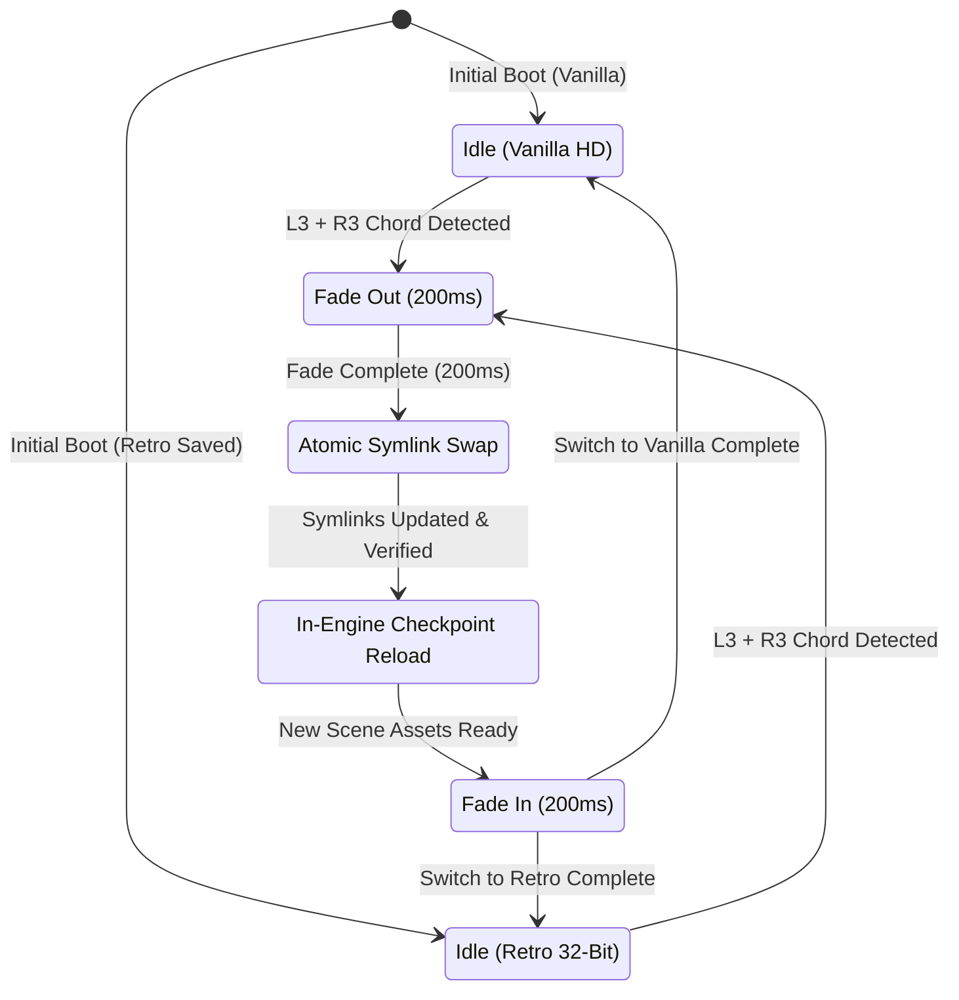

# Data Model & State Machine: In-Game On-Demand Retro Mod Switcher

**Feature Branch**: `003-realtime-graphics-toggle`  
**Date**: 2026-11-09  
**Status**: Completed  

---

## 1. Core Entities

### 1.1 `VisualMode` (Enumeration)
Defines the active aesthetic presentation.
- `VANILLA_HD`: Pristine modern high-definition FromSoftware baseline (`CUSA03173/`).
- `RETRO_5PILLAR`: 32-bit low-poly retro overhaul across all 5 decoupled pillars (`mods/`).

### 1.2 `ToggleInputState`
Tracks real-time controller sampling and chord debouncing.
- `buttons_current`: `uint32` - Active pad button mask from `PadData.buttons`.
- `l3_pressed`: `bool` - `(buttons_current & BTN_L3) != 0`.
- `r3_pressed`: `bool` - `(buttons_current & BTN_R3) != 0`.
- `chord_active`: `bool` - `l3_pressed && r3_pressed`.
- `last_trigger_timestamp`: `uint64` - Monotonic clock (ms) when last toggle was executed.
- `debounce_duration_ms`: `uint32` - `3000` ms lockout.
- `is_locked`: `bool` - `(current_time - last_trigger_timestamp) < debounce_duration_ms`.

### 1.3 `OverlayMountState`
Represents the filesystem virtual overlay managed by `bbport`.
- `overlay_root`: `Path` - Path to active `out/mod-game-*`.
- `active_mode`: `VisualMode` - Currently mounted mode.
- `vanilla_source`: `Path` - Path to pristine `CUSA03173/dvdroot_ps4/`.
- `retro_source`: `Path` - Path to merged 5-pillar structure in `mods/`.
- `swap_in_progress`: `bool` - True during atomic symlink replacement.

### 1.4 `ReloadTransitionState`
Controls the visual fade and in-engine checkpoint reload lifecycle.
- `phase`: `TransitionPhase` - Current lifecycle phase:
  - `IDLE`: Normal gameplay running.
  - `FADING_OUT`: Executing 200ms cross-dissolve fade to black.
  - `SWAPPING_OVERLAY`: Atomic filesystem redirect occurring.
  - `TRIGGERING_RELOAD`: In-engine stage warp / checkpoint reload requested.
  - `AWAITING_SCENE_LOAD`: Engine loading new FLVER/TPF/HKX assets into memory.
  - `FADING_IN`: Executing 200ms fade back to gameplay.
- `phase_start_timestamp`: `uint64` - Timestamp when current phase was entered.
- `fade_duration_ms`: `uint32` - `200` ms.

### 1.5 `ModSwitcherConfig` (Persistent State)
Persisted configuration in `out/retro_toggle_state.json`.
- `schema_version`: `string` - `"1.0.0"`.
- `active_mode`: `VisualMode` - `"RETRO_5PILLAR"` or `"VANILLA_HD"`.
- `hotkey_binding`: `string` - `"L3+R3"`.
- `fade_duration_ms`: `int` - `200`.
- `last_updated_iso`: `string` - ISO 8601 timestamp.

---

## 2. State Machine: Mode Switch Lifecycle

---

## 3. Validation Rules & Invariants

1. **Debounce Invariant**: No reload request can be dispatched if `(now - last_trigger_timestamp) < 3000ms`.
2. **Atomicity Invariant**: The symlink swap must complete within the 200ms fade-out window before FromSoftware's guest file loader begins reading the next scene.
3. **Immutability Invariant**: Neither `CUSA03173/` nor `~/.local/share/bbhost/data/saves` may ever be modified by the switcher.
4. **All-or-Nothing Invariant**: All 5 pillars (Maps, Props, Armors, Characters, HUD) must pivot simultaneously; partial pillar switching is disallowed.
