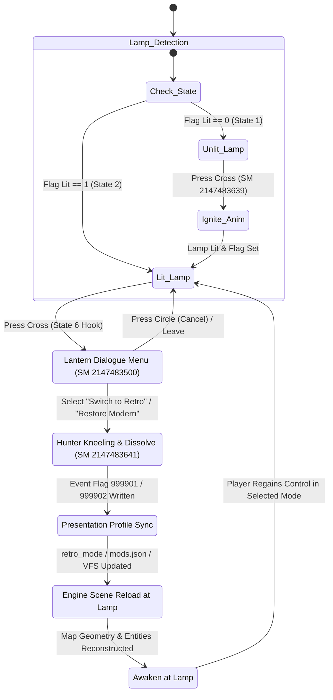

# Data Model & State Machine: Native In-Game Lantern Mod Switcher

**Feature Branch**: `004-native-lantern-switcher`  
**Date**: 2026-11-10 (Revised)  
**Status**: Ready  

---

## 1. Domain Entities

### 1.1 `LanternDialogueOption`
Defines an interactive menu selection presented in the lantern interaction dialog.
- `option_id`: `int` - Unique dialogue entry ID (`1` for Hunter's Dream, `20` for Retro Demake, `21` for Modern HD, `99` for Leave).
- `fmg_entry_id`: `int` - `70011001` (Hunter's Dream), `70011010` (Retro), `70011011` (Modern), `15000005` (Leave).
- `target_state_id`: `int` - Destination state in SM `2147483500` (`1`, `20`, `21`, or `19`).
- `event_flag`: `Optional[int]` - `999901` (Retro) or `999902` (Modern).

### 1.2 `EventFlagSignal`
Represents the in-engine communication flag exchanged between FromSoftware's event engine and the host environment.
- `flag_id`: `int`:
  - `999901`: Switch to `RETRO_5PILLAR`.
  - `999902`: Switch to `VANILLA_HD`.
- `state`: `bool` - Current flag state (`True` when requested, `False` when cleared/idle).
- `timestamp_ms`: `uint64` - Monotonic timestamp when flag was observed.

### 1.3 `EzStateMenuGraph`
Defines the state and condition topology for SM `2147483500` to prevent frame 0 termination.
- `State 0 (Menu Root)`:
  - `enter_commands`: `ClearTalkListData()`, `AddTalkListData(1)`, `AddTalkListData(20)`, `AddTalkListData(21)`, `AddTalkListData(99)`, `ShowShopMessage(0,0,0)`.
  - `conditions`:
    - `Choice 1`: `GetTalkListEntryResult() == 1` -> State 1.
    - `Choice 20`: `GetTalkListEntryResult() == 20` -> State 20.
    - `Choice 21`: `GetTalkListEntryResult() == 21` -> State 21.
    - `Cancel/Leave`: `GetTalkListEntryResult() == 0 or GetTalkListEntryResult() == 99` -> State 19.
- `State 1 (Return to Dream)`: Calls SM `2147483643` with vanilla args.
- `State 20 (Switch Retro)`: Sets Flag `999901`, calls SM `2147483641(MACHINE_ARGS[0], MACHINE_ARGS[1], 0)`.
- `State 21 (Restore Modern)`: Sets Flag `999902`, calls SM `2147483641(MACHINE_ARGS[0], MACHINE_ARGS[1], 0)`.
- `State 19 (Terminal)`: Exits to parent machine (`-1`).

---

## 2. State Machine: Lantern Toggle Lifecycle

---

## 3. Data Invariants

1. **Unlit Lamp Invariant**: SM `2147483644` State 7 enter commands MUST remain `[Command(bank=6, index=2147483639, args=[B, C, D])]`. No custom menu injection may intercept State 7.
2. **Menu Persistence Invariant**: SM `2147483500` State 0 conditions MUST NOT evaluate `IsTalkExclusiveMenuOpen() == 0` on frame 0.
3. **Safety Invariant**: Player blood echoes, insight, and inventory counts must remain byte-identical across the reload.
4. **Baseline Immutability**: Pristine retail game directory (`CUSA03173/`) remains 100% read-only.
